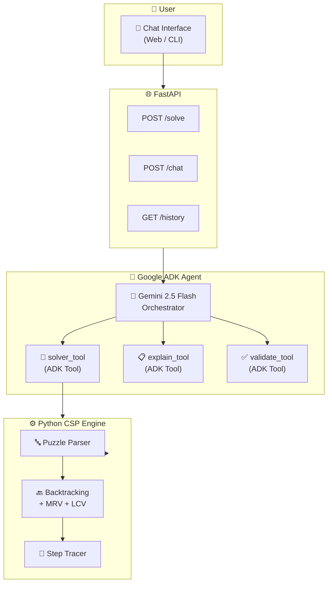

<div align="center">

# 🔢 Cryptarithmetic × Google ADK

**AI-Powered Puzzle Solver with Gemini Intelligence**

[](https://github.com/harinish45/cryptarithmetic-adk-python/actions/workflows/ci.yml)
[](LICENSE)
[](https://python.org)
[](https://ai.google.dev)
[](https://google.github.io/adk-docs)
[](vercel.json)

> *Solves cryptarithmetic puzzles using Google ADK + Gemini 2.5 Flash with step-by-step reasoning and conversational explanations*

[📋 TODO](TODO.md) · [🧪 Test Chat](test_chat.py) · [🚀 Live Demo](#)

</div>

---

## 🏗️ Architecture



---

## 💬 Example Conversation

```
You: Solve SEND + MORE = MONEY

Gemini: Let me work through this step by step...
        Setting up constraints: S≠0, M≠0, all digits unique
        Running MRV heuristic — assigning M=1 first (most constrained)
        ...
        ✅ Solution found!
        S=9, E=5, N=6, D=7, M=1, O=0, R=8, Y=2
        9567 + 1085 = 10652 ✓

You: Why did you assign M=1 first?

Gemini: M appears in the result's leftmost position...
```

---

## 🚀 Quick Start

```bash
git clone https://github.com/harinish45/cryptarithmetic-adk-python.git
cd cryptarithmetic-adk-python

pip install -r requirements.txt

# Set your Gemini API key
export GEMINI_API_KEY="your-key-here"

# Test the agent
python test_chat.py

# Start web server
uvicorn api.main:app --reload
```

---

## 📁 Structure

```
cryptarithmetic-adk-python/
├── 🤖  cryptarithmetic_agent/  # Google ADK agent + tools
├── 🌐  api/                   # FastAPI backend
├── 🖥️  public/                # Frontend assets
├── 🧪  test_chat.py           # Chat test harness
└── ⚙️  vercel.json            # Deployment config
```

---

<div align="center">
<a href="https://google.github.io/adk-docs">Google ADK Docs</a> · <a href="LICENSE">MIT License</a> · Built by harinish45
</div>